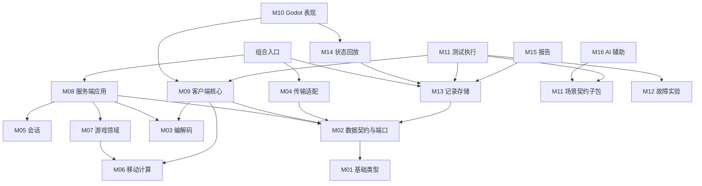

# NetArena 模块解耦与依赖设计

| 项目 | 内容 |
| --- | --- |
| 版本 / 日期 | v0.1 / 2026-10-17 |
| 状态 | 设计契约草案；本文所列类和接口尚未实现或通过互通验证 |
| 需求依据 | [项目需求说明书](./项目需求说明书.md)、[功能需求说明书](./功能需求说明书.md) |
| 接口手册 | [服务端与客户端接口设计](./服务端与客户端接口设计.md)、[测试回放与AI接口设计](./测试回放与AI接口设计.md) |

## 1. 设计目标与原则

本设计将需求拆成可以单独理解、测试和替换的模块。模块是代码组织和依赖边界，不代表每个模块都需要独立进程、动态库、仓库或微服务。

1. 游戏规则不依赖 Socket、ENet、Godot、文件系统、Python 或模型服务。
2. 应用层负责协调流程，模块之间通过明确参数、返回值和不可变事件传递信息。
3. 客户端和服务器共享简单移动计算，但只有服务器能决定拾取、得分和结算。
4. 网络包、业务命令、记录事件分别建模，避免直接把对象内存发送到网络或把含凭证的网络包写进日志。
5. 仅在确实存在替换需求处定义接口：传输、记录、时钟、凭证来源、模型服务。首版不为每个普通类创建抽象基类。
6. 首版只有一个活动房间。保留明确的房间对象边界，不实现多房间调度平台。

## 2. 模块目录与职责

下列路径是计划结构，不表示目录已经创建。M01–M16 为跨文档稳定编号。

| 编号 | 模块 / 计划目录 | 主要类 | 负责 | 不负责 |
| --- | --- | --- | --- | --- |
| M01 | 基础类型 `shared/foundation/` | `Result<T>`、`IClock`、`SteadyClock` | ID、单位、错误、时间抽象 | 游戏规则、网络消息 |
| M02 | 数据契约 `shared/contracts/`、`schemas/` | 各类 DTO、`ITransport`、`ITraceSink`、`ITokenProvider` | 消息、事件、端口及版本化格式 | 流程执行、磁盘和网络实现 |
| M03 | 协议编解码 `shared/protocol/` | `ProtocolCodec` | 对象与字节互转、结构限制 | 身份授权、判定输赢 |
| M04 | 传输适配 `adapters/transport/` | `EnetTransport` | 连接、收发、通道和底层统计 | 玩家、房间和玩法 |
| M05 | 会话 `server/session/` | `SessionService` | 握手后的访客身份、凭证、连接替换、超时 | 房间容量、地图实体 |
| M06 | 移动计算 `shared/movement/` | `MovementModel` | 固定步长移动、静态碰撞和限幅 | 拾取、得分、通信、引擎物理 |
| M07 | 游戏领域 `server/game/` | `Room`、`MatchSimulation`、`InputBuffer` | 房间状态机、权威游戏、动作顺序和业务去重 | 连接句柄、Token、序列化、记录落盘 |
| M08 | 服务端应用 `server/app/` | `ServerApp`、`CommandRouter`、`TickScheduler`、`SnapshotPublisher` | 将网络、会话、游戏、同步及记录串联 | 直接实现碰撞或 UDP 协议 |
| M09 | 客户端核心 `client/core/` | `ClientRuntime`、`PredictionController`、`SnapshotBuffer` | 客户端会话、输入发送、预测、校正、插值 | Godot 节点、美术、场景编排 |
| M10 | Godot 表现 `client/godot/` | `NetArenaBridge`、`LobbyPresenter`、`ArenaPresenter`、`DebugPresenter` | UI、输入采集、渲染、C++ 桥接 | 直接修改服务器状态、实现业务协议 |
| M11 | 测试场景与执行 `tools/testing/`、`apps/bot/` | `ScenarioValidator`、`ScenarioRunner`、`BotAgent`、`AssertionEngine` | 校验、进程编排、机器人、断言、清理 | 修改游戏规则、模型调用 |
| M12 | 故障实验 `tools/faults/`、`tests/fixtures/` | `UdpFaultProxy`、`MessageFaultFixture` | 隔离 UDP 故障、测试专用业务故障 | 正常发布版中的业务作弊入口 |
| M13 | 记录存储 `adapters/trace/`、`tools/evidence/` | `AsyncTraceRecorder`、`TraceArchiveReader`、`EvidenceReader` | 有界异步写入、格式校验、读取和索引 | 决定断言结果、AI 解释 |
| M14 | 状态回放 `client/replay/` | `ReplayController` | 历史快照定位、播放、插值标记 | 联网、重新运行游戏逻辑 |
| M15 | 报告 `tools/reporting/` | `ReportBuilder` | 汇总结果、定位证据、比较运行 | 代替断言引擎重新判定游戏对错 |
| M16 | AI 辅助 `tools/ai/` | `IModelClient`、`ScenarioGenerator`、`GenerationEvaluator` | 自然语言转场景、校验修正、评测 | 启动测试、访问实时房间、执行生成代码 |

`server_main`、`bot_main`、Godot 原生扩展入口和 Python CLI 为组合入口：创建具体实现并注入依赖，不承载业务规则。

## 3. 允许的直接依赖

箭头 `A → B` 表示 A 可以引用 B 的公开接口；B 不因此知道 A。接口的实现关系和运行时消息方向不等于反向代码依赖。

| 模块 | 允许直接依赖的项目模块 | 禁止的典型依赖 |
| --- | --- | --- |
| M01 | 无 | 其余所有模块 |
| M02 | M01 | 任何具体适配器 |
| M03 | M01、M02 | M04、M05、M07 |
| M04 | M01、M02 | M05、M07、M10 |
| M05 | M01、M02 | M04、M07 |
| M06 | M01、M02 | M07、M09、Godot |
| M07 | M01、M02、M06 | M03、M04、M05、M13、M16 |
| M08 | M01、M02、M03、M05、M07 | M10、M11、M16 |
| M09 | M01、M02、M03、M06 | M05、M07、M08、Godot |
| M10 | M01、M02、M09、M14 | M07、M08、M16 |
| M11 | M01、M02、M09、M12、M13 | M07、M08、M16 的业务实现 |
| M12 | M01、M02、M03 | M07 的私有可变状态 |
| M13 | M01、M02 | M07、M08、M11、M14、M16 |
| M14 | M01、M02、M13 | M07、M08、M09、M16 |
| M15 | M01、M02、M13 | M07、M08、M16 |
| M16 | M01、M02、M11 的 `scenario_contract` 子包 | M11 的执行器、M07、M08、M09 |

M11 内部进一步分为 `scenario_contract`（数据与纯校验，仅依赖 M01/M02）、`runner`、`assertions` 和 `bot`。M16 只引用前者，导入校验器不会导入执行器、启动子进程或形成循环依赖。M11 的 C++ bot 依赖 M09；Python runner 通过本地进程控制接口操作 bot，不链接 C++ 游戏领域。

M08 和 M09 的构造函数使用 M02 的 `ITransport`、`ITraceSink` 等接口。M04、M13 的具体实现由组合入口传入，因此不需要 M08/M09 反向引用适配器。

图中仅展示主要依赖，完整直接依赖以上表为准。

## 4. 进程、线程和对象所有权

### 4.1 服务端

首版一个服务端进程，包含一个逻辑线程和一个记录写入线程。

- 逻辑线程独占 `ServerApp`、`SessionService`、`Room`、`MatchSimulation` 和传输实例。网络轮询非阻塞，每轮有事件数和时间预算。
- 记录线程只消费不可变的事件/快照副本，不持有 Room、Session 或玩家对象指针。
- 通过 `unique_ptr` 在组合入口管理长生命周期组件。借用引用必须比调用者活得更久；默认不使用互相持有的 `shared_ptr`。
- 不将磁盘写入、模型调用、外部进程等待放进逻辑 Tick。

网络轮询与逻辑更新同线程是四人首版的简化选择。未来拆 I/O 线程时，仍只通过有界值队列向逻辑线程交付命令，不能从 I/O 线程修改房间。

### 4.2 客户端与机器人

- Godot 主线程调用 `NetArenaBridge`，桥接层持有一个 `ClientRuntime`；其公开方法不阻塞主线程。
- 每个机器人进程持有一个相同的 `ClientRuntime`，通过本地控制接口接收测试命令。
- 机器人复用连接、输入和快照处理；图形场景、渲染及键盘输入不进入客户端核心。
- 回放使用独立的 `ReplayController`，不需要连接服务器，也不会复用在线会话状态。

### 4.3 测试与 AI

- Python runner 在独立进程中启动本次测试所需的服务端、机器人和 UDP 代理，拥有这些进程的清理责任。
- UDP 代理只代理本次测试的端口，不修改机器全局网络设置。
- AI 生成是独立命令：产出场景后退出；执行测试使用另一条命令。runner 不导入模型 SDK。
- 断言用结构化证据判定，报告模块消费断言结果；AI 不决定 PASS/FAIL。

## 5. 关键决策

### 5.1 网络实现与 Godot 桥接

首版拟选 ENet 适配器，但必须先完成互通和构建验证。C++ 服务端、C++ 机器人和 Godot 原生扩展内的 C++ 客户端使用同一版本的传输适配器；Godot 负责表现，不依赖 Godot 高层多人 RPC 协议。

这需要打包原生扩展，但可共享客户端通信和移动计算，避免同时维护 GDScript 与 C++ 的游戏协议实现。本设计不宣称当前已锁定依赖版本或验证平台，具体版本和构建方式须在验证记录中登记。

应用消息首版采用有长度上限的 UTF-8 JSON 信封，协议接口与具体 JSON 库解耦。选择 JSON 便于检查和构造测试；不将其当作高性能最终方案。ID 和 64 位序号在线上使用十进制字符串，避免跨语言数值精度丢失。

### 5.2 通道语义

| 通道 | 语义 | 消息 |
| --- | --- | --- |
| Control | 可靠有序 | 握手、进房、准备、开始、拾取、结算、重连、完整恢复快照 |
| Input | 可靠有序，独立于 Control | 首版固定步长移动输入 |
| Snapshot | 不可靠、可丢弃旧版本 | 周期性权威快照 |

首版为降低输入补发复杂度使用可靠输入，接受弱网时可能产生队头阻塞的代价；服务器用有界队列和过期策略避免积压扩散。优化成冗余不可靠输入属于后续实验，不隐含在 P0 中。可靠消息的 `send` 返回成功只代表进入本地发送队列，不代表对端已收到或业务已执行。

### 5.3 游戏状态与规则

- Room 拥有成员表和一个 MatchSimulation；MatchSimulation 拥有局内玩家、金币和得分。
- SessionService 拥有身份、凭证摘要及连接映射；它不能访问金币或修改得分。
- 跨模块协调都由 ServerApp 执行。会话断线只产生 `SessionTransition`，随后由应用层调用 Room 的断线处理。
- 客户端共享 `MovementModel`，不链接 Room 或拾取判定逻辑。
- 数据契约中的 Snapshot 为值对象；客户端持有的是副本，不是领域对象。

## 6. 关键调用流程

### 6.1 移动与同步

1. Godot 收集方向 → `ClientRuntime.submit_move()` 生成输入序号并更新本地预测。
2. `ProtocolCodec.encode()` → `ITransport.send()` 发送 Input 消息。
3. 服务端轮询网络 → 解码 → SessionService 验证当前连接和 epoch → CommandRouter 转为已授权命令。
4. Room 将输入放入 InputBuffer；固定 Tick 取出可执行输入，调用 MovementModel，再处理本帧拾取。
5. SnapshotPublisher 生成包含终结输入水位的快照，经 Codec/Transport 发出；同时投递已脱敏记录。
6. 客户端丢弃旧快照，移除已终结的预测输入，在权威状态上重放未确认输入，更新显示状态。

### 6.2 断线重连

1. 会话心跳超时或连接断开 → SessionService 生成断线转换，并固定恢复截止时间。
2. ServerApp 将玩家标为离线、归零移动并清空未执行输入；Room 保留局内状态。
3. 恢复请求经凭证验证后，SessionService 增加 epoch 并绑定新连接；旧连接立即失效。
4. ServerApp 调用 Room 恢复在线状态，向新连接可靠发送完整快照；客户端清除旧 epoch 的预测缓存。
5. 失效旧连接的迟到断开事件不得再次让新连接掉线。超过保留期的身份由应用层通知 Room 移除实体。

### 6.3 AI 生成到故障回放

1. ScenarioGenerator 调用模型，ScenarioValidator 执行结构和语义检查。
2. 用户保存并确认配置后，另行调用 ScenarioRunner。
3. runner 启动隔离进程、配置代理、通过 BotAgent 执行动作；真实规则仍由服务器决定。
4. recorder 写入结构化证据，AssertionEngine 判定，ReportBuilder 输出报告。
5. Godot 回放界面通过 ReplayController/TraceArchiveReader 查看失败时刻；该步骤不调用模型或服务器。

## 7. 错误、记录和生命周期约束

- 可预期失败统一返回 `Result<T>`；正常“没有新事件”使用空集合或 `optional`，不伪装成错误。
- `SessionId/PlayerId` 由服务端确定，客户端提交的 ID 只能用于一致性检查，不能替代连接认证。
- 每个请求带操作标识；服务端响应区分传输接收、命令接受和业务最终结果。
- 输入去重范围为 `(MatchId, PlayerId, Epoch, InputSeq)`；拾取幂等范围为 `(MatchId, PlayerId, ActionId)`，跨重连保持 ActionId。
- 记录队列满时不能阻塞游戏；必须设置持久的“记录不完整”状态，最终清单和测试结果反映缺失证据。
- 程序停止先拒绝新业务，再关闭连接、结束记录，最后销毁依赖对象；记录刷新具有时间上限。

## 8. 需求覆盖与模块验证

| 需求 | 主要模块 | 独立验证方式 |
| --- | --- | --- |
| FR-01、02 | M03、M04、M05、M08 | 畸形消息、假传输、固定时钟、伪凭证 |
| FR-03、04 | M07、M08 | 不连接网络，直接验证房间状态转换 |
| FR-05、06 | M06、M07、M08 | 固定地图和命令，验证移动、争抢、去重和过载 |
| FR-07、08 | M03、M08、M09、M10 | 快照乱序、预测输入终结、渲染状态分离 |
| FR-09、10 | M05、M07–M10 | 时钟推进、连接替换、遥测来源检查 |
| FR-11、12、13 | M09、M11 | 无模型、无渲染的端到端场景与断言 |
| FR-14 | M12 | 实际 UDP 代理统计、受控业务故障夹具 |
| FR-15、16、17 | M13、M14、M15 | 文件夹具、损坏文件、缺失数据、报告关联 |
| FR-18、19、20 | M16、M11 场景契约 | 假模型响应、拒绝样例、固定生成评测集 |

未来代码检查应约束上述依赖矩阵：C++ 按目标分组限制 include/link，Python 禁止从契约子包反向导入 runner，Godot 场景只访问桥接对象与展示 DTO。不能仅靠目录名宣称解耦完成。

## 9. 开发顺序与设计边界

建议顺序：基础/契约 → 编解码与传输互通验证 → 移动/房间/会话 → 服务端应用 → 客户端核心/表现 → 记录 → 机器人/故障/断言 → 回放/报告 → AI。

实现前需验证的工程事项是具体依赖版本、原生扩展构建、目标平台发布和基准环境。本文已经定义模块行为、调用和错误契约，但不替代实际互通、性能与安全验证，也不将接口草案当作可直接编译的代码。
